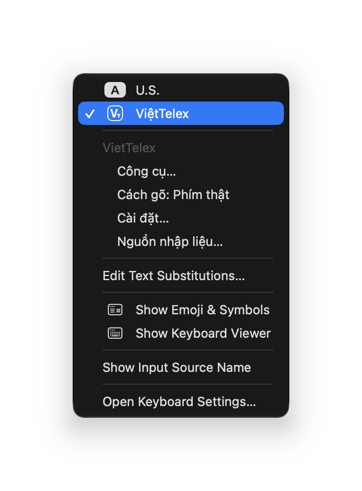
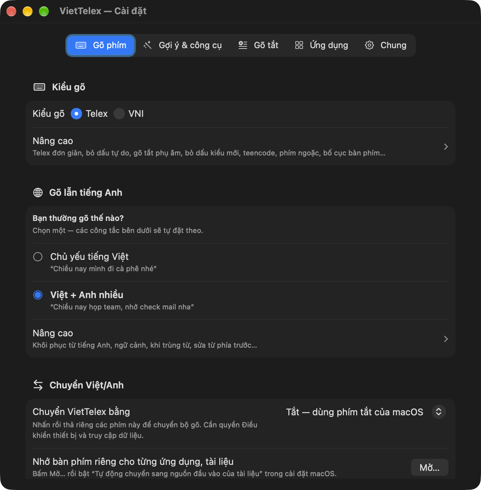
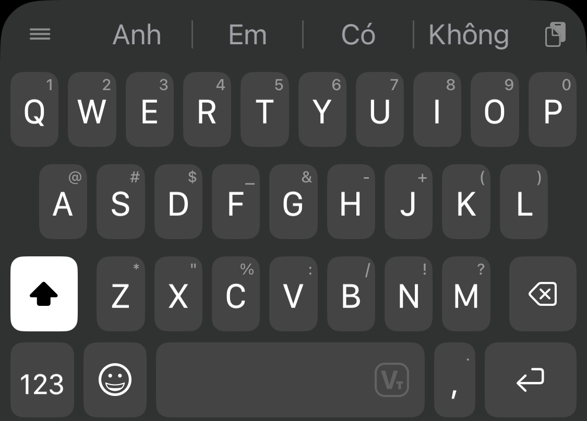

<p align="center">
  
</p>

<h1 align="center">VietTelex</h1>

<p align="center">
  <a href="https://github.com/ptrinh/viettelex/actions/workflows/ci.yml"></a>
  <a href="https://github.com/ptrinh/viettelex/releases/latest"></a>
  <a href="https://github.com/ptrinh/viettelex/releases"></a>
  <a href="LICENSE"></a>
  
</p>

**VietTelex** (ViệtTelex / ViếtTelex) là bộ gõ tiếng Việt **Telex** và **VNI**, miễn phí và mã nguồn mở, cho **iPhone, iPad, Android, macOS, Windows và Linux**. Cài xong là gõ; nhanh, gọn, gõ đúng trong mọi app.

| Nền tảng | Yêu cầu | Cách cài | Mã nguồn |
|---|---|---|---|
| [iPhone & iPad](https://viettelex.com/download/?os=ios) | iOS 16+ | App Store | [`iOS/`](iOS) |
| [Android](https://viettelex.com/download/?os=android) | Android 8+ | Google Play, APK | [`android/`](android) |
| [macOS](https://viettelex.com/download/?os=macos) | macOS 13+ | `.pkg`, Homebrew | [`App/`](App) |
| [Windows](https://viettelex.com/download/?os=windows) | Windows 10 / 11 | Microsoft Store, `.msi`, portable | [`windows/`](windows) |
| [Linux](https://viettelex.com/download/?os=linux) | Ubuntu, Debian, Fedora, Arch | một lệnh cài | [`linux/`](linux) |

> Dự án của **Phil Trịnh**, bắt đầu trên macOS sau gần 20 năm chưa thấy bộ gõ tiếng Việt nào thật sự *ngon, chuẩn, mượt*, nay có đủ cho điện thoại và máy tính.

https://github.com/user-attachments/assets/1d9bdef1-f814-4070-9b2d-01436f7d3020

<p align="center"><sub>VietTelex trong 33 giây — gõ Telex/VNI trên máy tính và điện thoại, giữ nguyên từ tiếng Anh, có gõ vuốt và nhiều tính năng tiện dụng.</sub></p>

## Điểm nổi bật

- **Bàn phím thật của hệ thống** — tích hợp thẳng vào iOS, Android, macOS, Windows và Linux; không phải ứng dụng chặn phím.
- **Phản hồi nhanh** — xử lý mỗi phím trong khoảng **130 ns** theo benchmark trên Mac; gõ liên tục vẫn mượt.
- **Gõ đúng ở những chỗ khó** — terminal, thanh địa chỉ trình duyệt, Excel, Word.
- **Giữ nguyên tiếng Anh và mã lệnh** — `google`, `github`, `JavaScript`… không bị bỏ dấu nhầm.
- **Đầy đủ trên điện thoại** — gợi ý từ, gõ vuốt, mẫu câu, clipboard, emoji, giao diện tuỳ chỉnh.
- **Độ chính xác được kiểm thử** — 9.091 trường hợp: đúng **100%** từ tiếng Việt, khôi phục **98,9%** từ tiếng Anh ([chi tiết](docs/REGRESSION.md)).
- **Riêng tư** — không thu thập nội dung bạn gõ, không quảng cáo, không theo dõi ([chi tiết](https://viettelex.com/privacy-policy.html)).

| macOS: menu trên thanh menu | macOS: cửa sổ Cài đặt |
|---|---|
|  |  |

<p align="center"><br><sub>iPhone: bàn phím VietTelex với thanh gợi ý</sub></p>

## Cài đặt

Tải và hướng dẫn từng bước: **[viettelex.com/download](https://viettelex.com/download/)** · Hướng dẫn sử dụng: [viettelex.com/hdsd](https://viettelex.com/hdsd/)

- **iPhone & iPad** — [App Store](https://apps.apple.com/app/id6794425455), rồi thêm VietTelex trong Cài đặt → Bàn phím.
- **Android** — [Google Play](https://play.google.com/store/apps/details?id=com.viettelex.android) hoặc APK, mở app rồi bấm **Bật VietTelex**.
- **Windows** — [Microsoft Store](https://apps.microsoft.com/detail/xp9cbqk2f77356), `.msi` hoặc bản portable; cài xong là gõ được.
- **Linux** — `curl -fsSL https://viettelex.com/install.sh | bash`
- **macOS** — `.pkg` hoặc `brew install --cask ptrinh/viettelex/viettelex`

<details>
<summary><strong>macOS: các bước cài</strong></summary>

Chọn **một** cách cài: Homebrew hoặc `.pkg`. Cả hai cài cùng app đã ký vào
`~/Library/Input Methods/VietTelex.app`; không cài song song vì hai bộ quản lý sẽ
cùng ghi/xoá một app. Khi đổi từ Homebrew sang `.pkg`, chạy
`brew uninstall --cask viettelex` trước. Khi đổi từ `.pkg` sang Homebrew, chuyển
sang ABC, thoát VietTelex, xoá app ở đường dẫn trên rồi mới chạy lệnh Homebrew.

1. Nếu chọn `.pkg`, tải **`VietTelex-x.y.z.pkg`** ở [trang tải](https://viettelex.com/download/?os=macos) hoặc [Releases](https://github.com/ptrinh/viettelex/releases) (đã ký + notarized).
2. Double-click → làm theo hướng dẫn (tự cài vào thư mục user, đăng ký bộ gõ, mở sẵn System Settings → Keyboard).
3. **Input Sources → Edit… / ＋ → Vietnamese → ViệtTelex → Add.**

| ① Input Sources → Edit… | ② ＋ → Vietnamese → ViệtTelex → Add |
|---|---|
|  |  |

Để gõ trong **Terminal, iTerm, Chrome/Edge/Brave**: cấp quyền cho VietTelex trong Privacy & Security → **Accessibility** (macOS 26 trở về trước) / **Device Control and Data Access** (macOS 27). Chuyển Việt/Anh bằng phím 🌐 hoặc ⌃Space (macOS nhớ theo từng app).
</details>

## Cách gõ

`s f r x j` = sắc huyền hỏi ngã nặng · `aa ee oo` = â ê ô · `aw ow uw` = ă ơ ư · `dd` = đ · `z` xóa dấu.
Ví dụ: `vieejt` → việt · `truowngf` → trường · `hoas` → hóa.

Chọn Telex hay VNI và các tuỳ chọn khác trong Cài đặt của VietTelex trên từng nền tảng.

**Gõ kiểu VNI:** dấu gõ bằng số: `1-5` = sắc/huyền/hỏi/ngã/nặng, `6` = â/ê/ô, `7` = ơ/ư, `8` = ă, `9` = đ, `0` = bỏ dấu (ví dụ `Vie6t5` → Việt). Nên bật **Kiểm tra chính tả khi gõ** để các chuỗi như `mp3` không bị hiểu nhầm thành dấu.

## FAQ — câu hỏi thường gặp

Các câu dưới đây dành cho **macOS**. Windows, Linux, iPhone và Android: xem [hướng dẫn sử dụng](https://viettelex.com/hdsd/).

<details>
<summary><strong>Cài xong gõ vẫn bị gạch chân?</strong></summary>

Nếu chữ bị gạch chân, có thể VietTelex chưa được cấp quyền. Mở Cài đặt hệ thống (System Settings) → Quyền riêng tư & Bảo mật (Privacy & Security) → **Trợ năng** (Accessibility, macOS 26 trở về trước) / **Điều khiển thiết bị và truy cập dữ liệu** (Device Control and Data Access, macOS 27), rồi bật VietTelex. Lưu ý: mục "Trợ năng" ở thanh bên trên macOS 27 là cài đặt hỗ trợ nhìn/nghe, không phải chỗ cấp quyền. Nếu đã bật mà vẫn lỗi, hãy chọn VietTelex, bấm − để xoá rồi bấm + thêm lại (từ ~/Library/Input Methods). Có thể cần khởi động lại máy để quyền có hiệu lực.

Nếu đã bật quyền mà VietTelex vẫn báo thiếu, hãy kiểm tra bản đang chạy. Bản Debug
trong Xcode có định danh riêng và không dùng quyền của bản cài trong
`~/Library/Input Methods`; thoát bản Debug rồi mở lại bản đã cài. Nếu bản đã cài
vẫn báo thiếu, xoá mục VietTelex khỏi Accessibility rồi thêm lại ứng dụng trong
`~/Library/Input Methods`.
</details>

<details>
<summary><strong>Đã bật quyền mà VietTelex vẫn báo thiếu quyền?</strong></summary>

Hiếm gặp, thường do quyền còn "kẹt" với bản cài cũ. Cập nhật lên bản mới nhất trước (từ 1.8.32 VietTelex tự nhận quyền vừa bật, không cần khởi động lại). Nếu vẫn báo thiếu:

1. Trong **Điều khiển thiết bị và truy cập dữ liệu** (macOS 27) / **Trợ năng** (macOS 26 trở về trước), chọn VietTelex rồi bấm **−** để xoá hẳn (không chỉ tắt).
2. Mở Terminal, chạy:
   ```
   tccutil reset Accessibility com.viettelex.inputmethod.telex
   ```
3. Chuyển sang bộ gõ khác rồi chuyển lại VietTelex (hoặc đăng xuất/đăng nhập). Khi VietTelex hỏi quyền, bấm cho phép và bật lại.
</details>

<details>
<summary><strong>Không thấy ViệtTelex trong danh sách bộ gõ?</strong></summary>

Đăng xuất/đăng nhập lại một lần rồi thêm lại.
</details>

<details>
<summary><strong>Một ứng dụng cụ thể gõ lỗi?</strong></summary>

Menu bộ gõ → **Cài đặt…** → tab **Ứng dụng** → chọn ứng dụng vừa dùng hoặc nhập mã ứng dụng, rồi thử cách gõ phù hợp. Nếu chưa biết nên chọn gì, hãy để **Tự động**. Khi đã tìm được cách gõ đúng, [báo lại trên GitHub](https://github.com/ptrinh/viettelex/issues/new/choose) để mọi người cùng dùng được.
</details>

<details>
<summary><strong>Có hỗ trợ VNI không?</strong></summary>

Có, trên mọi nền tảng. Trên macOS: **Cài đặt…** → tab **Gõ phím** → chọn **VNI**.
</details>

<details>
<summary><strong>Ô mật khẩu không gõ được tiếng Việt?</strong></summary>

VietTelex tự tắt trong secure field — đúng hành vi bảo mật, không phải lỗi.
</details>

<details>
<summary><strong>Mở máy từ sleep, đang mở 1Password thì không gõ được Telex?</strong></summary>

Không riêng VietTelex: mọi bộ gõ bên thứ ba đều bị. 1Password giữ **Secure Input** của macOS sau khi ngủ (ô khoá vault vẫn “focus” dù bạn đang ở app khác) — macOS lúc đó vô hiệu mọi bộ gõ bên thứ ba.

Gỡ nhanh: bấm vào cửa sổ 1Password rồi bấm ra, hoặc **Quit 1Password**. Icon `Vᵀ⃠` trên menu bar (khi đang bị chặn) sẽ chỉ đúng hướng đó. Bộ gõ có sẵn của Apple (Simple Telex) thường vẫn dùng được vì không bị disable theo lớp IME bên thứ ba.

Chi tiết: [ghi chú kỹ thuật](docs/MACOS_IME_NOTES.md).
</details>

<details>
<summary><strong>Gõ comment trên TikTok (Safari) bị mất chữ cuối khi ấn Enter?</strong></summary>

**Bấm một dấu cách trước khi ấn Enter** là đủ chữ. Hoặc dùng Chrome cho TikTok.

Lý do: ô comment của TikTok chỉ ghi nhận từ đang gõ khi có một phím thật đi sau nó — Enter thì không đủ. Bộ gõ đã thử sáu cách xử lý hộ và không cách nào giữ được từ cuối (chi tiết trong [ghi chú kỹ thuật](docs/MACOS_IME_NOTES.md)), nên đây là giới hạn đã biết chứ không phải lỗi chưa sửa.
</details>

<details>
<summary><strong>Gỡ cài đặt thế nào cho sạch?</strong></summary>

Gỡ khỏi Input Sources chỉ tắt bộ gõ, chưa xoá app. Gỡ hẳn: xoá **`~/Library/Input Methods/VietTelex.app`** (Finder → Go → Go to Folder…) rồi đăng xuất/đăng nhập. Muốn xoá luôn cài đặt cá nhân (gõ tắt, tuỳ chỉnh): xoá thêm `~/Library/Preferences/com.viettelex.settings.plist`. Cài bằng Homebrew thì chỉ cần `brew uninstall --cask viettelex`.
</details>

<details>
<summary><strong>Gõ Remote Desktop (Chrome Remote Desktop) bị nhảy dấu?</strong></summary>

Khi **cả hai máy** đều cài VietTelex, bộ gõ local và bộ gõ remote cùng sửa một chuỗi phím — dấu Backspace của tap đua với Telex bên kia, con trỏ nhảy loạn.

**Cách đúng:** để VietTelex bật trên **máy đang bị điều khiển** (máy remote). Máy đang ngồi gõ tự tắt IME trong phiên remote (cùng cách với Windows App / Screen Sharing). Tab `remotedesktop.google.com` được nhận ra theo URL; các app RDP native đã passthrough sẵn.

Muốn gõ tiếng Việt vào ô tên máy / PIN trên trang Chrome Remote Desktop: chuyển sang ABC, hoặc gõ không dấu.

Cần quyền Trợ năng (macOS 27: Điều khiển thiết bị và truy cập dữ liệu) để bộ gõ đọc được URL tab (Chrome vốn đã cần quyền này).
</details>

<details>
<summary><strong>Phím tắt trong app chụp màn hình (Flameshot…) không ăn?</strong></summary>

Lỗi của framework Qt (Flameshot, OBS, VLC… dùng): shortcut trong overlay bị nuốt khi có **bất kỳ** bộ gõ nào đang active — bộ gõ Simple Telex có sẵn của Apple cũng dính y hệt, không riêng VietTelex ([chi tiết](https://github.com/ptrinh/viettelex/issues/54)). Khắc phục: System Settings → Keyboard → bật **"Automatically switch to a document's input source"**, rồi một lần chuyển sang ABC khi đang ở app đó — macOS sẽ tự nhớ, các app khác vẫn gõ tiếng Việt bình thường.
</details>

## Đóng góp & giấy phép

Gặp lỗi? Xem [hướng dẫn báo lỗi kèm cách lấy nhật ký gỡ lỗi](BAO-LOI.md) rồi [mở issue](https://github.com/ptrinh/viettelex/issues/new).

Build, kiến trúc, benchmark: xem [`docs/CONTRIBUTE.md`](docs/CONTRIBUTE.md) · độ chính xác: [`docs/REGRESSION.md`](docs/REGRESSION.md) · latency: [`docs/BENCHMARKS.md`](docs/BENCHMARKS.md).

[MIT License](LICENSE) — © 2026 Phil Trinh. Tự do dùng/sửa/tích hợp (kể cả thương mại), miễn giữ lại thông báo bản quyền.
